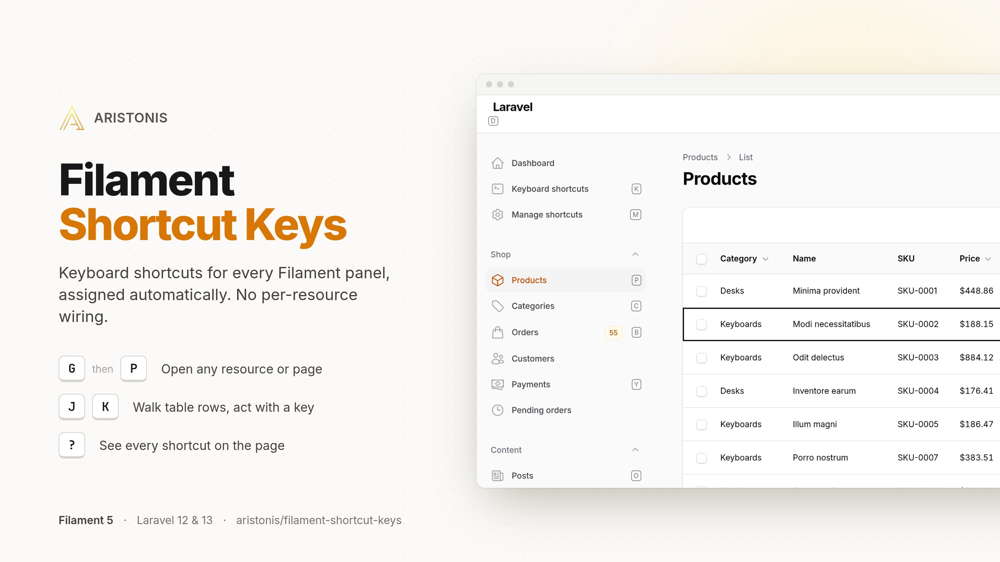

# Filament Shortcut Keys

## مقدّمة

Filament Shortcut Keys إضافة (`plugin`) للوحات تضيف اختصارات لوحة المفاتيح إلى لوحة Filament 5 من دون أي إعداد لكل مورد على حدة. عندما تُعرَض صفحة، تقرأ الإضافة الموارد (`resources`) والصفحات المسجّلة في اللوحة، وإجراءات الترويسة في الصفحة وجداولها، وتعطي كلًّا منها مفتاحًا، ثم ترسل خريطة المفاتيح (`keymap`) الناتجة إلى المتصفح. وعندما تضيف موردًا، يحصل على اختصار.

كل اختصار يضغط عنصر التحكم الحقيقي في Filament أو يتبع الرابط (`URL`) الحقيقي. فسياساتك (`policies`) والـ `middleware` ونوافذ التأكيد تُطبَّق تمامًا كما تُطبَّق على نقرة بالفأرة.

## الاختصارات في لمحة

بعد تسجيل الإضافة، تتوفّر في كل صفحة من اللوحة هذه المفاتيح:

| المفاتيح | ما تفعله |
| --- | --- |
| `G` ثم حرف | فتح مورد أو صفحة |
| حرف | تشغيل أحد إجراءات الترويسة في الصفحة الحالية |
| `/` | تركيز حقل البحث في الجدول |
| `J` / `K` | بدء مؤشّر الصف وتحريكه للأسفل / للأعلى |
| `Space`، `Enter`، `Delete` | تحديد الصف الذي يقف عليه المؤشّر أو تعديله أو حذفه |
| `?` | فتح ورقة الاختصارات للصفحة الحالية |

ويمكنك أيضًا أن تعطي إجراءات السجلات الخاصة بك في الجداول مفتاحًا، مثل `approve` أو `reject`. انظر [إجراءات الصفوف](row-actions.md).

## تخصيص الاختصارات

يستطيع كل مشرف إعادة تعيين مفاتيح التنقّل الخاصة به أو تعطيلها، وإضافة روابط خاصة به، من صفحة **Manage shortcuts**. ويمكنك بدلًا من ذلك قفل اللوحة على خريطة مشتركة واحدة، أو إبقاء كل المفاتيح في ملف الإعدادات. أمّا تعديل الإعدادات المسبقة المشتركة التي ينطلق منها الجميع فصلاحية منفصلة، مرفوضة إلى أن تمنحها. انظر [السماح للمشرفين بالتخصيص](customization.md).

## قراءة أسماء المفاتيح

أسماء المفاتيح في هذا التوثيق هي ما هو مطبوع على أغطية المفاتيح. فـ `G` تعني مفتاح G مضغوطًا وحده، من دون `Shift`. والتسلسل مثل "`G` ثم `O`" يعني أن تضغط `G` وترفع إصبعك عنه، ثم تضغط `O`.

## الخطوات التالية

لإضافة الإضافة إلى لوحة، اتّبع [دليل التثبيت](installation.md).
