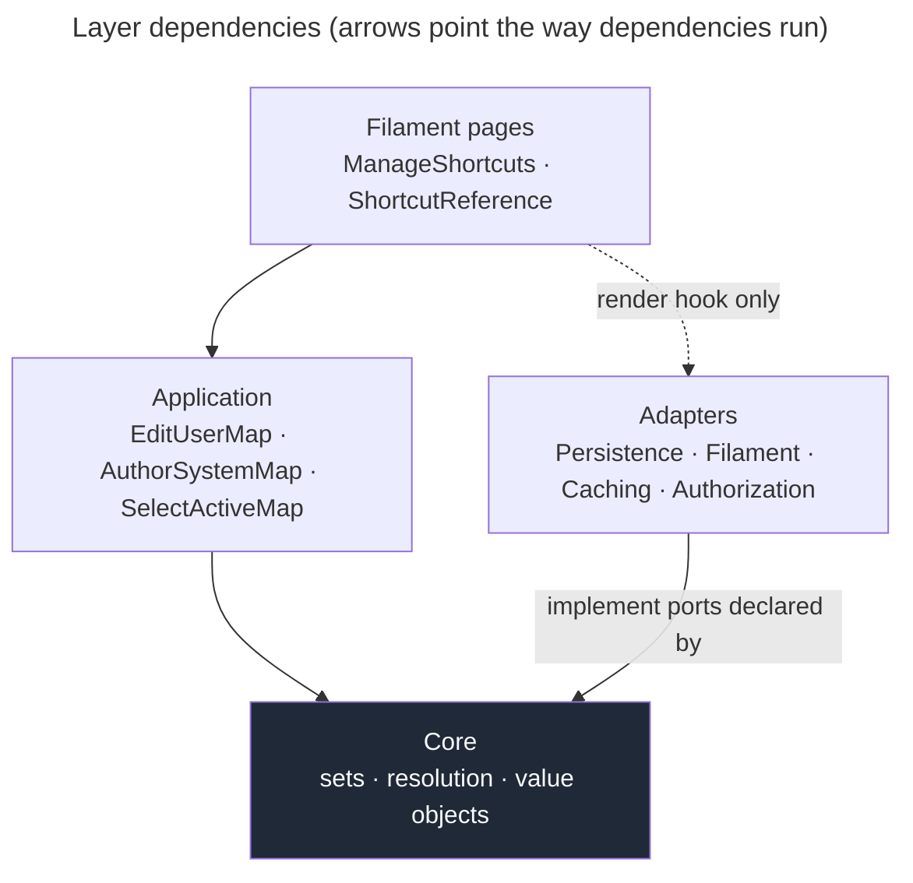
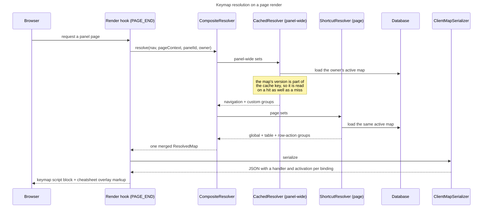

# ملاحظات التصميم

كيف رُكّبت الإضافة، ولماذا اتخذت هذا الشكل. اقرأ هذا قبل تغيير أي شيء في
`src/Core`، فهناك تقع القرارات ذات نطاق التأثير الأوسع.

تُشحن الحزمة على شكل إضافة لوحة في Filament v5، لكن منطق الاختصارات لا يعرف شيئًا عن Filament.
كل ما هو خاص بـ Filament يقع خلف منفذ (`port`)، وهذا ما يتيح اختبار قواعد الحلّ
على مصفوفات عادية بدلًا من لوحة مُقلَعة (`booted`).

## الطبقات

`src/Core` هو PHP خالص: كائنات القيمة، وتعريفات المجموعات، وخط معالجة الحلّ. ليس فيه أي
استيرادات لإطار عمل ولا أي معرفة بعناوين URL أو محدِّدات CSS أو Eloquent أو الحاوية. وكل ما
يحتاجه من العالم الخارجي يصل إليه عبر واجهة يعلنها هو بنفسه.

`src/Application` يحتوي حالات الاستخدام التي تستدعيها الواجهة: تعديل خريطة شخصية، وتأليف خريطة
مشتركة، واختيار الخريطة الفعّالة. هنا تقع فحوص الصلاحيات والوضع، فيحصل عليها كل
مستدعٍ سواء كان واجهة المستخدم المشحونة أو `controller` خاصًا بالتطبيق المضيف.

`src/Persistence` و`src/Filament` و`src/Caching` و`src/Authorization` هي مُحوّلات (`adapters`). وهي تنفّذ
منافذ النواة مقابل Eloquent، ولوحة Filament، والـ `cache` في Laravel، والـ `gate` في Laravel.

لا تشير النواة أبدًا إلى الخارج. يجوز للمُحوّل أن يعتمد على النواة؛ ولا يجوز للنواة أن تعتمد على
مُحوّل. إذا وجدت نفسك تريد استيرادًا من `Illuminate\` داخل `src/Core`، فما تحتاجه
هو منفذ جديد.

## المنافذ ومُحوّلاتها

| المنفذ | مُعلَن في | المُحوّل المشحون |
|---|---|---|
| `MapRepository` | `Core/Contracts` | `Persistence\EloquentMapRepository` |
| `MapEditor` | `Core/Contracts` | `Persistence\EloquentMapRepository` (النسخة نفسها) |
| `SystemMapAuthor` | `Core/Contracts` | `Persistence\EloquentSystemMapAuthor` |
| `ListMaps`، `MapSelector` | `Core/Contracts` | `Persistence\EloquentMapCatalog` (النسخة نفسها) |
| `NavigationProvider` (داخلي) | `Core/Contracts` | `Filament\FilamentNavigationProvider` |
| `PageContextProvider` (داخلي) | `Core/Contracts` | `Filament\FilamentPageContextProvider`، `NullPageContextProvider`، `AnyTablePageContextProvider` |
| `Resolver` (داخلي) | `Core/Contracts` | `Core\Resolution\ShortcutResolver`، `CompositeResolver`، `Caching\CachedResolver` |
| `ShortcutSet` (داخلي) | `Core/Contracts` | صنف واحد لكل مجموعة في `Core/Sets` |
| `ReservesKeys` (داخلي) | `Core/Contracts` | `Core\Sets\TableSet` |
| `AcceptsCustomBindings` (داخلي) | `Core/Contracts` | `Core\Sets\CustomSet` (واجهة وسم بلا دوالّ) |
| `AuthorityGate` | `src/Authorization` | `Authorization\ConfigAuthorityGate` |

المنافذ المُعلَّمة بأنها داخلية تحمل `@internal`. إنها مفاصل خط معالجة الحلّ نفسه وليست
نقاط توسعة: فالإضافة تبني كل مجموعة ومزوّد بنفسها، لذا قد تكتسب دوالّ جديدة في إصدار
فرعي.

`MapRepository` و`MapEditor` واجهتان منفصلتان عن قصد فوق صنف واحد: القرّاء يعتمدون
على عقد القراءة فقط، فلا يستطيع أي شيء يكتفي بحلّ خريطة مفاتيح أن يكتب عن طريق الخطأ. والفصل
نفسه ينطبق على `ListMaps` و`MapSelector`.

`SystemMapAuthor` منفصل عن `MapEditor` لسبب أوجه. فـ `MapEditor` يفرّع نسخة شخصية
قبل الكتابة؛ بينما `SystemMapAuthor` يغيّر إعدادًا مسبقًا مشتركًا في مكانه. هاتان عمليتان مختلفتان
بمخاطر مختلفة، ودمجهما في واجهة واحدة سيتيح لمستدعٍ الوصول إلى العملية الخطرة
بينما يطلب العملية الآمنة.

## حلّ خريطة المفاتيح لتصيير صفحة واحدة

يعمل الخطّاف عند `PanelsRenderHook::PAGE_END` ولا يعمل في أي موضع آخر. فالخطّافات على مستوى التخطيط (`layout`) تعمل خارج
مكوّن Livewire الخاص بالصفحة، حيث تعيد `Livewire::current()` القيمة null ولا يمكن اكتشاف المجموعات الخاصة
بالصفحة على الإطلاق.

وتُنشأ المجموعات أيضًا عند كل تصيير لا عند تسجيل الإضافة، لأن اتجاه نص اللوحة
يعتمد على اللغة المحلية للطلب، والـ `middleware` الخاص باللغة المحلية يعمل بعد تسجيل الإضافات بوقت طويل.

خطّاف التصيير ليس المستدعي الوحيد. فصفحة مرجع الاختصارات تُجري الحلّ مرتين، بعيدًا عن أي صفحة
حيّة. تشغّل `resolvePanelWideMap()` المحلِّل الخاص باللوحة كلها مقابل `NullPageContextProvider`، فتصل
إلى مُدخل الـ `cache` نفسه الذي يصل إليه خطّاف التصيير. وتشغّل `resolveTableMap()` مجموعات الصفحة مقابل
`AnyTablePageContextProvider`، أي جدول لا صفحة حوله: فتخرج مفاتيح الجدول وحرف كل إجراء صف
مسجّل، ولا تجد مجموعة إجراءات الترويسة شيئًا.

## الفصل بين السجلّين

تنقسم المجموعات بحسب ما إذا كانت محتوياتها تعتمد على الصفحة الحالية.

**على مستوى اللوحة كلها**: `NavigationSet` و`CustomSet`. متطابقتان في كل صفحة من صفحات اللوحة، لذا
تُخزَّن النتيجة مؤقتًا.

**على مستوى الصفحة**: `GlobalSet` و`TableSet` و`RowActionSet`. تختلف من صفحة إلى أخرى ورخيصة البناء، لذا
تُحلّ من جديد في كل مرة. وتشمل جداول الصفحة الجداولَ المتداخلة (الـ `relation managers` والـ `table
widgets`)، التي تُصيَّر بعد الصفحة؛ ويغطّي `resolution.md` كيف تتعامل مجموعة إجراءات الصفوف وورقة
الاختصارات مع ذلك.

يضمّ `CompositeResolver` النتيجتين بعضهما إلى بعض. وهذا لا يصحّ إلا لأن السجلّين لا يتشاركان أي مفتاح
مجموعة، وهو ثابت (`invariant`) تحافظ عليه طريقة توصيل الإضافة لا ما يفرضه `merge()`.

وللفصل نتيجتان أخريان، تعالجهما طريقة التوصيل كلتاهما. المفاتيح المحجوزة في مجمّع أحد السجلّين
يجب أن يحترمها السجلّ الآخر، لذا يُبنى `KeyReservations` من السجلّين معًا،
وتقع بادئة التنقّل في المجمّع المجرّد الذي تُسند منه مجموعات الصفحة أحرفها. ولا يجوز لمجمّع أحرف أن يمتدّ عبر
السجلّين، لأن كل محلِّل لا يُسند الأحرف إلا لمجموعاته: فوضع `global` أو `row-action` على
مخطط `navigation` أو `custom` يرمي استثناءً. كما تُسند إجراءات الصفوف أحرفها بنفسها قبل أن يعمل محلِّل الصفحة،
وتُمرَّر مفاتيحها إليه على أنها محجوزة سلفًا، فلا تعتمد أحرف إجراءات الترويسة على الجداول
الموجودة في الصفحة. انظر `resolution.md`.

مفتاح الـ `cache` بصمة تشمل إصدار صيغة الـ `cache`، ومعرّف اللوحة، ورمز إصدار
التنقّل، وهوية الخريطة الفعّالة (`type:id:version`)، وتجزئة (`hash`) لإعدادات المطوّر التي تشكّل
الخريطة (الـ `overlay`، ومخططات `modifiers`، والمفاتيح المحجوزة)، واللغة المحلية. يعني إصدار الصيغة
أنّ الترقية التي تغيّر شكل البيانات المخزّنة مؤقتًا تقرأ إخفاقًا (`miss`) بدلًا من أن تسيء تحليل مُدخل قديم. ولا
يتضمّن المفتاح عن قصد هوية المستخدم: فمشرفان على الخريطة نفسها يتشاركان مُدخلًا واحدًا. ولا
يتضمّن كذلك، عن قصد أيضًا، الصلاحيات، للسبب المبيّن أدناه.

تُشحن الحزمة مع مدة صلاحية محدودة للـ `cache` افتراضيًا. فالبصمة تضمن الحداثة وحدها، لكنها
تضمنها *بتغيير المفتاح*، ولا شيء يحذف المفتاح الذي ابتعدت عنه. ومدة الصلاحية هي ما
يستعيد تلك المفاتيح.

## خريطة المفاتيح علنية

كل صفحة مسجّلة تنتج اختصارًا، سواء كان المستخدم الحالي يستطيع الوصول إليها أم لا. وهذا هو
القرار الأكثر مخالفة للبديهة في الحزمة، لذا يستحق أن يُقال بوضوح.

تحدث الصلاحيات عند تشغيل الاختصار، لا عند بناء الخريطة أبدًا. فالاختصار يشغّل عنصر تحكم
حقيقيًا في Filament: عنصر التحكم غير المخوَّل لا يُصيَّر، والمسار غير المخوَّل يحجبه
الـ `middleware`، فلا يفعل تشغيل الاختصار شيئًا. وتصفية الخريطة بحسب الصلاحيات لن تشتري أي أمان
وستكلّف مُدخلًا في الـ `cache` لكل مستخدم مفتاحه بصمة صلاحيات يصعب
إبطالها على نحو صحيح.

والنتيجة العملية أنّ خريطة المفاتيح تكشف أيّ الصفحات *موجودة*، لا ما يُسمح للمستخدم بفعله. إذا كان
وجود صفحة بحدّ ذاته أمرًا حساسًا، فتلك الصفحة لا مكان لها في تنقّل اللوحة.

## من أين تبدأ القراءة

- `Core/Resolution/ShortcutResolver`: خط المعالجة الذي يمرّ به كل ربط. انظر `resolution.md`.
- `Core/Sets/*`: صنف واحد لكل مجموعة، يقرّر كلٌّ منها ما يكتشفه ونمط مفاتيحه الافتراضي.
- `Persistence/EloquentMapRepository`: النسخ عند الكتابة (`copy-on-write`) ومعالجة التزامن. انظر `domain-model.md`.
- `FilamentShortcutKeysPlugin`: التوصيل: السجلّات، وإنشاء المحلِّل، وخطّاف التصيير.
