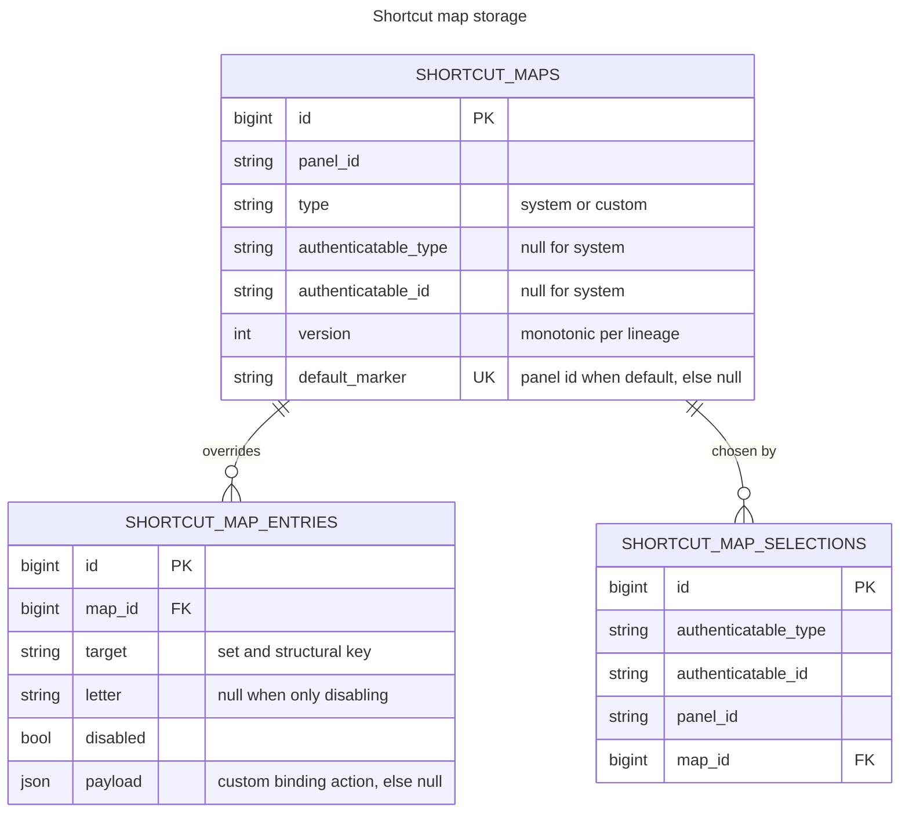
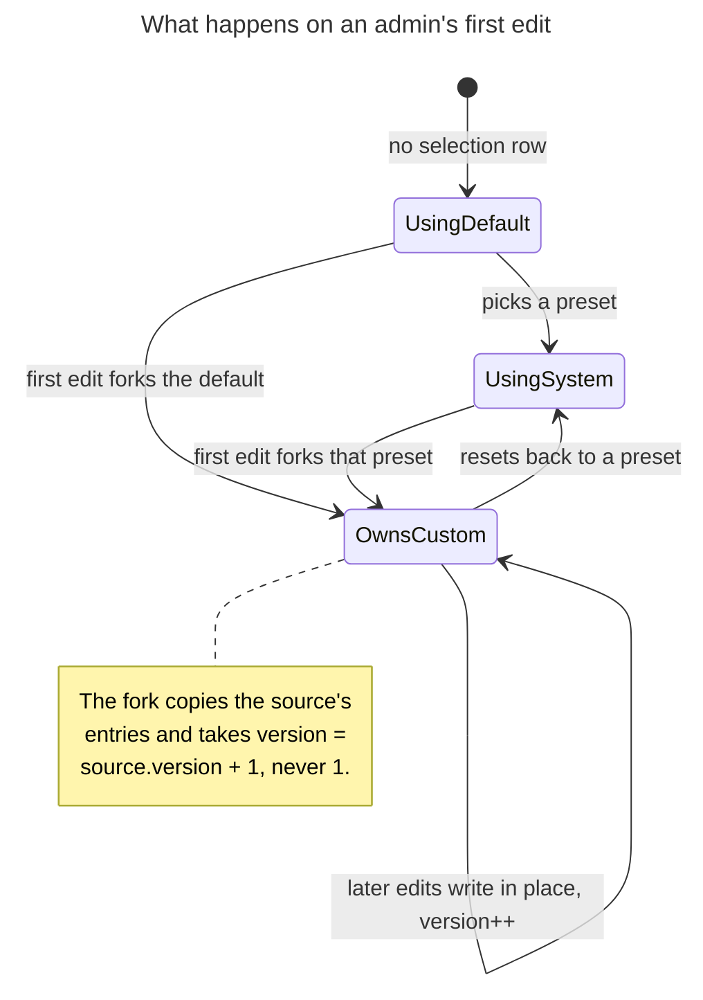

# نموذج المجال

ثلاثة جداول، وثلاثة ثوابت، وعملية واحدة يجب أن تكون صحيحة في ظل التزامن. إذا كنت
تغيّر أي شيء في طريقة تخزين الخرائط أو تفريعها، فاقرأ قسم الثوابت أولًا: فكلٌّ منها
مفروض بقيد في قاعدة البيانات اختير ليتصرّف بالطريقة نفسها على MySQL وPostgreSQL وsqlite.

## المخطط

المالك متعدّد الأشكال (`polymorphic`) ويُخزَّن على شكل نصّين عاديين، لأن التطبيقات المضيفة تعرّف المستخدمين بمفاتيح
integer أو UUID أو ULID والنواة تعامل المعرّف على أنه معتِم. والعمودان كلاهما محدودان بـ 191 حرفًا
للبقاء ضمن حدّ طول الفهرس في utf8mb4 لدى MySQL.

لا تخزّن الخريطة **إلا الفروق**. كل ما لا تذكره الخريطة يمرّ إلى محرّك الأعراف
الحيّ، وهذا ما يتيح لمورد مُضاف حديثًا أن يظهر في الخريطة المخصّصة لمشرف
دون المساس بصفوفه المخزّنة.

تحمل الخريطة أحرفًا وتعطيلات وروابط مخصّصة، ولا تحمل أبدًا نمط مفاتيح. فطريقة ضغط مفاتيح كل مجموعة
(بادئة، أو مفاتيح مجرّدة، أو مفاتيح تعديل ممسوكة) تُضبط مرة واحدة لكل عملية نشر في إعداد `modifiers`.

## الثوابت

**خريطة فعّالة واحدة لكل مشرف في كل لوحة.** فهرس فريد على
`(authenticatable_type, authenticatable_id, panel_id)` في جدول الاختيارات. وهذا القيد
هو أيضًا نقطة التسلسل (`serialization point`) لعملية التفريع الموصوفة أدناه، لذا فهو يؤدّي عملًا أكبر ممّا
يبدو.

**خريطة نظام افتراضية واحدة لكل لوحة.** تُفرض عبر علامة قابلة لأن تكون null بدلًا من فهرس جزئي:
يحمل `default_marker` معرّف اللوحة للخريطة الافتراضية وnull فيما عدا ذلك، مع فهرس فريد عادي
على العمود. وكل مشغّل (`driver`) مدعوم يسمح بقيم null متعدّدة في الفهرس الفريد، بينما الفهارس المرشَّحة أو
الجزئية غير قابلة للنقل بين قواعد البيانات، إذ لا يملك MySQL أيًّا منها.

**تجاوز واحد لكل هدف في كل خريطة.** فهرس فريد على `(map_id, target)`. وبادئته الأقصى يسارًا
تخدم أيضًا عمليات البحث بـ `map_id`، فلا حاجة إلى فهرس مستقل على ذلك العمود.

أمّا جدول الاختيارات فيحمل فهرسًا صريحًا على `map_id`، لأن PostgreSQL لا يفهرس أعمدة
المفاتيح الخارجية تلقائيًا، والحذف المتتالي (`cascade delete`) ومسار التنظيف في عملية التفريع كلاهما يرشّحان بحسبه.

## النسخ عند الكتابة

لا يعدّل المشرف أبدًا خريطة مشتركة. أول كتابة تفرّعها.

الإصدارات متزايدة رتيبًا لكل سلالة بدلًا من أن تبدأ من جديد عند 1. فالتفريع الذي يعود إلى 1 سيتصادم
مع الإصدار 1 لخريطة النظام نفسها لدى المشرف نفسه، ولأن الإصدار جزء من هوية
الـ `cache`، فستُحلّ الخريطتان المختلفتان إلى مفتاح الـ `cache` نفسه.

كل تغيير في المحتوى يرفع الإصدار. وهذا ما يُبطل الـ `cache`، لذا فإن التعديل الذي يتخطّى الرفع
سيقدّم خريطة المفاتيح السابقة للتعديل إلى أن يتغيّر شيء آخر.

## سباق التفريع

يجب أن ينتج عن تعديلين أوّلين شبه متزامنين من المشرف نفسه خريطة مخصّصة واحدة بالضبط دون أن
يضيع أيّ من التعديلين. وكيفية تحقيق ذلك تعتمد على ما إذا كان صف الاختيار موجودًا مسبقًا.

**صف الاختيار موجود.** يُقفل عبر `lockForUpdate` ويُعاد توجيهه. والتفريع المتزامن ينتظر
على قفل الصف حتى يُثبِّت (`commit`) الأول. لا غموض في ذلك.

**لا يوجد صف اختيار.** لا يوجد صف يمكن قفله، لذا يكون القيد الفريد هو نقطة التسلسل:
يبني الطلبان كلاهما خريطة مخصّصة، ويحاول كلاهما حجز الموضع عبر إدراج عادي، ويلتقط الخاسر
المخالفة، ويتخلّص من خريطته التي صارت زائدة، ويلتقي على خريطة الفائز.

هذا الاسترداد ملفوف داخل نقطة حفظ (`savepoint`)، ويجب أن يبقى كذلك. فـ PostgreSQL يتخلّى عن
المعاملة كلها بعد أي عبارة فاشلة، لذا من دون نقطة الحفظ سيجري تنظيف الخاسر وبحثه
داخل معاملة تخلّى عنها الخادم مسبقًا، فيُرفع الخطأ `25P02` ويضيع التعديل
بدلًا من الالتقاء. ويقود `tests/Concurrency/ForkRaceTest.php` هذا السباق على PostgreSQL.

تصل المشغّلات إلى النتيجة نفسها عبر طرق مختلفة، وهذا يستحق المعرفة قبل كتابة اختبار
لهذا. على PostgreSQL، عبارة `SELECT ... FOR UPDATE` التي لا تطابق أي صف لا تقفل شيئًا، فيمضي الطلبان كلاهما
ويحسم القيد الأمر. أمّا InnoDB فيضع قفل فجوة (`gap lock`) على النطاق بدلًا من ذلك، فينتظر الطلب الثاني ببساطة.
والنتيجة بالنسبة إلى الاختبار أنّ السباق لا يمكن قيادته من عملية واحدة على MySQL: فالاتصال
الثاني ينتظر الأول، بينما ينتظر الأول أن يعود الاختبار.

## الأهداف والهوية الثابتة

هوية الربط هي `set:structureKey`، على سبيل المثال
`navigation:App\Filament\Resources\OrderResource` أو `row-action:approve`. والمفتاح البنيوي هو
اسم صنف أو اسم إجراء ثابت، وليس أبدًا `slug` أو عنوانًا.

هذا ما يتيح للتجاوز المخزَّن أن ينجو من إعادة التسمية ومن إعادة الترتيب كلتيهما. ويعني أيضًا أنّ التجاوز قد
يعيش بعد زوال الشيء الذي يشير إليه، ولهذا تشحن الحزمة `shortcut-keys:prune` بدلًا من
حذف الصفوف تلقائيًا: فخارج الطلب لا يستطيع الأمر التمييز بين "هذا الإجراء حُذف"
و"هذا الإجراء غير موجود في هذه الصفحة"، لذا لا يحذف إلا التجاوزات التي يستطيع إثبات
زوال هدفها إثباتًا قاطعًا.
