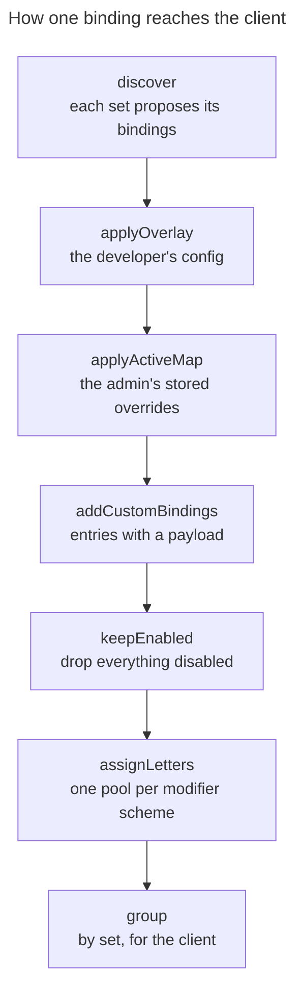

# الحلّ

كيف تتحوّل مجموعة من الموارد المسجّلة إلى خريطة مفاتيح يستطيع المتصفح التصرّف بناءً عليها. هذا هو الجزء من
الحزمة الذي يحوي أكبر عدد من القواعد في كل سطر، لذا يستحق فهم الترتيب قبل تغيير أي مرحلة.

## خط المعالجة

تشغّل `ShortcutResolver::resolve()` سبع مراحل بترتيب ثابت. والترتيب مهم في كل خطوة تقريبًا.



**discover** تسأل كل مجموعة مسجّلة عمّا تريد ربطه. والمجموعة التي لا تجد شيئًا ينطبق على
الصفحة الحالية تعيد قائمة فارغة: `TableSet` في صفحة لا جدول فيها، و`RowActionSet` حيث لا يعرض
الجدول أيًّا من الأسماء المسجّلة.

ويمكن للصفحة أيضًا أن تضمّ جداول ليست جداولها. تكون `hasNestedTables()` صحيحة عندما تعرض الصفحة
`relation manager` أو `widget` في الترويسة أو التذييل أو لوحة المعلومات يكون جدولًا، وتحتسب `hasTable()`
هذه الجداول، فتحصل مثل هذه الصفحة على مفاتيح الجدول. الجدول المتداخل مكوّن Livewire مستقل
يُصيَّر بعد الصفحة، لذا تكون إجراءات صفوفه مجهولة عند بناء خريطة المفاتيح: في مثل هذه الصفحة
تحتفظ `RowActionSet` بكل اسم مسجّل، وتُعلِّم ورقة الاختصارات كل صف من تلك الصفوف بـ
`data-fsk-presence`، فلا تُظهره إلا ما دام في الصفحة صف يحمل ذلك الإجراء. ولا يُكتشف أي شيء
آخر. الجدول الموضوع عبر مخطط `content()` الخاص بالصفحة أو `Livewire::make()`، أو الـ `widget` الموضوع
عبر `getWidgetsSchemaComponents()`، لا يمنح الصفحة أي مفاتيح جدول ما لم تكن الصفحة نفسها صفحة
جدول.

**applyOverlay** تطبّق إعدادات المطوّر. يتحوّل الحرف المفروض إلى تركيبة مفاتيح ثابتة
فورًا، قبل الإسناد، فيوجّه المُسنِد كل شيء آخر حولها. أمّا التعطيل فيُعلَّم هنا فقط،
ولا يُزال.

**applyActiveMap** تطبّق التجاوزات المخزّنة للمشرف بالطريقة نفسها. الأهداف التي لا تذكرها الخريطة
تمرّ دون مساس، وهذا ما يجعل الخريطة المخزّنة مجموعة من الفروق لا لقطة كاملة.
ولأنها تعمل ثانيًا، فإن الحرف المخزَّن يحلّ محلّ حرف ثبّته الـ `overlay` للهدف نفسه،
والتعطيل المخزَّن يوقف ذلك الهدف؛ ولا يستطيع حرف مخزَّن إعادة هدف عطّله الـ `overlay`.

**addCustomBindings** تضيف المُدخلات التي تحمل حمولة ولا يقابلها ربط من الأعراف، فهذه مفاتيح
جديدة، لا تجاوزات. ولا تقبلها إلا مجموعة مُعلَّمة بـ `AcceptsCustomBindings`، وهذا يمنع حمولة
مرفقة، مثلًا، بهدف جدول من إزاحة اختصار حقيقي.

**keepEnabled** تُسقط كل ما عُلِّم بأنه معطّل. وهي تعمل *قبل* الإسناد عن قصد: فحرف الاختصار
المعطَّل يعود إلى المجمّع بدلًا من أن يبقى محجوزًا لشيء غير مرئي.

**assignLetters** تجمع الروابط في مجمّعات بحسب مخطط مفاتيح التعديل الفعلي لكلٍّ منها وتُسند الأحرف داخل كل مجمّع، لأن
الروابط التي تتشارك مخططًا هي وحدها التي يمكن أن تتعارض. يأخذ كل ربط أول حرف متاح من تلميح
الحرف الخاص به (العنوان بالنسبة إلى التنقّل، والاسم بالنسبة إلى إجراءات الترويسة وإجراءات الصفوف والروابط المخصّصة)، ثم
يتراجع عبر الأبجدية. والمفاتيح المحجوزة أو المحجوزة سلفًا (`claimed`) في المجمّع (انظر أدناه) لا تُختار أبدًا.
والروابط التي تحمل أصلًا تركيبة مفروضة تحتفظ بها، ويُوجَّه غيرها حولها.

**group** تفرز النتيجة بحسب المجموعة وترفق مخطط كل مجموعة، فتعطي الشكل الذي يحوّله
المُسلسِل إلى JSON.

## مخططات مفاتيح التعديل

| المجموعة | المخطط الافتراضي | ملاحظات |
|---|---|---|
| `navigation` | البادئة `g` | تتشارك مجمّع أحرف مع `custom` |
| `custom` | البادئة `g` | روابط يعرّفها المشرف |
| `global` | مجرّد | إجراءات الصفحة الحالية؛ تتشارك المجمّع المجرّد مع `row-action` |
| `table` | مجرّد | مفاتيح ثابتة، لا تُسنَد أحرف |
| `row-action` | مجرّد | أحرف ثابتة على مستوى اللوحة |

المخططات قابلة للضبط لكل مجموعة. والمجموعة التي لا تذكرها الإعدادات أبدًا تحتفظ بعرفها، لذا فإن إزالة
سطر تعيد القيمة الافتراضية بدلًا من أن تحوّل الاختصارات بصمت إلى مفاتيح مجرّدة. ورمز مفتاح التعديل
غير المعروف يرمي استثناءً بدلًا من أن يُتجاهَل.

المجموعات التي تتشارك مخططًا تتشارك مجمّعًا، لذا تتنافس `navigation` و`custom` على الأحرف فيما بينهما
لكن ليس أبدًا مع `global`.

## الأحرف المفروضة

الحرف المفروض هو تثبيت في الـ `overlay` أو حرف مخزَّن في الخريطة الفعّالة للمشرف. تحوّله `forcedCombo()`
إلى تركيبة مفاتيح في مخطط المجموعة نفسها، ولا تعيد null إلا في حالتين: الحرف
ليس ضمن a–z، أو مفتاحه محجوز في ذلك المجمّع. وعندها يحتفظ الاختصار بحرفه التلقائي. وأي حرف
مفروض آخر يعمل على أي مجموعة، بما فيها المجموعات المجرّدة. ويشغّل تثبيت الـ `overlay` أيضًا إجراء الترويسة
الذي يعمل عند الضغط نفسه، والذي تتركه `GlobalSet` موقوفًا على المفاتيح المجرّدة؛ وهكذا يحصل مثل هذا الإجراء
على مفتاح.

في المُسنِد، يأخذ الحرف المفروض مفتاحه من اختصار مُسنَد إليه حرف تلقائيًا، فينتقل ذلك الاختصار إلى
حرف آخر متاح. وعندما يقع حرفان مفروضان على مفتاح واحد في مجمّع، فالأول في ترتيب المجمّع يحتفظ
به ويُسقَط اللاحق. ترتيب المجمّع هو ترتيب الاكتشاف: التنقّل قبل الروابط المخصّصة،
وإجراءات الترويسة قبل إجراءات الصفوف.

يُعدّ حرف إجراء الصف مفروضًا، لأن `RowActionSet` تضبطه قبل أن يعمل المحلِّل (انظر
أدناه). لذا فإن تثبيت إجراء صف على حرف شقيقه يترك تركيبتين ثابتتين على مفتاح واحد،
والإجراء الذي يأتي لاحقًا في `->rowActions([...])` يُسقَط: مع `['approve', 'reject']`، تثبيت `approve` على
`r` يعطي approve المفتاح `R` ويترك reject بلا مفتاح.

## المفاتيح المحجوزة والمحجوزة سلفًا

يبني `KeyReservations`، لكل مجمّع، المفاتيح التي لا يجوز لأي حرف أخذها. كل مجموعة تنفّذ `ReservesKeys`
تساهم بمفاتيحها (`/` و`J` و`K` والأسهم وبقية مفاتيح الجدول)، وكل مفتاح بادئة يدخل في
المجمّع المجرّد، لأن البادئة نفسها تُضغط مجرّدة. ويُبنى من السجلّين معًا،
لأن بادئة التنقّل تعيش في السجلّ الخاص باللوحة كلها لكن يجب أن تبقى خارج المجمّع المجرّد
الذي تُسند منه مجموعات الصفحة أحرفها. ويرمي استثناءً عندما تكون البادئة أحد مفاتيح الجدول المجرّدة، لأن ضغطها
سيبدأ انتظارًا بدلًا من أداء وظيفة الجدول.

وترفض الإضافة أيضًا مجمّعًا منقسمًا عبر السجلّين. فكل سجلّ يُسند أحرفه محلِّلُه
الخاص، لذا فإن `global` أو `row-action` على مخطط `navigation` أو `custom` نفسه قد يمنح مفتاحًا واحدًا
لاختصارين؛ وهذا الإعداد يرمي استثناءً يسمّي المجموعة.

إجراءات الصفوف تُسند أحرفها بنفسها. تُسند `RowActionSet` الأحرف على امتداد القائمة المسجّلة كاملة، متجنّبة
المفاتيح المحجوزة في المجمّع والأحرف التي يثبّتها الـ `overlay` للمجموعات الأخرى في ذلك المجمّع، ثم لا تحتفظ إلا
بالأسماء الموجودة في الصفحة. وتُمرَّر الرموز الناتجة إلى محلِّل الصفحة على أنها رموز محجوزة سلفًا (`claimed`) في
المجمّع: فالحرف التلقائي يتجنّبها، لذا لا يعتمد حرف إجراء الترويسة على
الجداول الموجودة في الصفحة، بينما يظلّ الحرف المفروض قادرًا على أخذ أحدها.

## مطابقة المفاتيح

تُطابَق المفاتيح على أساس المفتاح الفعلي (`event.code`)، لا الحرف الناتج. لذا يقع الاختصار
على المفتاح الفعلي نفسه بغضّ النظر عن تخطيط لوحة المفاتيح أو اتجاه النص.

التنقّل بين الصفحات هو الاستثناء الذي يؤكّد القاعدة. ففي لوحة من اليمين إلى اليسار يُبدَّل السهمان
على جانب الخادم، لأن Filament يقلب عنصري التحكم السابق والتالي الخاصين به، والمفتاح الذي يتحرّك في الاتجاه الخطأ
سيكون صحيحًا بحسب الموضع الفعلي وخاطئًا بحسب المعنى. وحسم ذلك على جانب الخادم يُبقي أيضًا
صفحة المرجع وورقة الاختصارات تعرضان المفتاح الذي يعمل فعلًا.

## الأسبقية

عندما يمكن لمفتاح واحد أن يطابق أكثر من مجموعة فعّالة، يحسم العميل الأمر بترتيب ثابت:

```
custom > table > global > navigation
```

الترتيب بحسب معالج العميل، لذا فإن إجراءات الصفوف، التي يشغّلها معالج `table`، تقع في مستوى
الجدول. ولا تُعلِّم ورقة الاختصارات الفائزين بالأسبقية، لأنه مع المجموعات المشحونة لا يمكن لفئتين
الوصول إلى التركيبة نفسها: فكل مجمّع يُسند أحرفه محلِّل واحد، ومجمّعات المحلِّلين تُبقى
منفصلة، ومفاتيح الجدول الثابتة محجوزة في كليهما.

## ما يتلقّاه العميل

يحقن خطّاف التصيير كتلة JSON تحتوي، لكل فئة، على مفتاح المجموعة، ومعالج العميل الذي يشغّلها،
ومفاتيح التعديل الممسوكة، ومفتاح البادئة (null حين لا توجد بادئة)، والروابط. ويحمل كل ربط
هدفه، ورمز مفتاحه الفعلي، وطريقة تفعيل تصف ما يجب فعله: الانتقال إلى
عنوان URL، أو ضغط محدِّد، أو تشغيل سلوك جدول مسمّى. والربط المخصّص الذي ليس محدِّده CSS صالحًا
أو لا يطابق شيئًا لا يفعل شيئًا عند الضغط، والمسار الذي لا يستطيع البحث عن الشارة مطابقته لا يحصل على شارة؛
ولا يوقف أيٌّ منهما بقية خريطة المفاتيح.

لهذا الفصل أهميته. تبقى النواة خالية من عناوين URL والمحدِّدات، فهي تتعامل مع الأهداف وتركيبات
المفاتيح، ويحوّل `ClientMapSerializer` هذه إلى شيء قابل للتنفيذ باستخدام
المزوّدين أنفسهم الذين اكتشفوها.

المعالجات مفهرسة بالمجموعة، لكن المجموعة لا يلزم أن يشغّلها معالج بالاسم نفسه.
فـ `RowActionSet` مفتاحها `row-action` ومعالجها `table`، لأن تشغيل إجراء صف يحتاج إلى
مؤشر الصف المُركَّز الخاص بمعالج الجدول.

## الصلاحيات وقت التشغيل

الاختصار يضغط عنصر تحكم حقيقيًا في Filament أو يتبع مسارًا حقيقيًا. ولا يخترع أبدًا إجراءً ذا
امتيازات، ولا يستدعي أبدًا دالة Livewire مباشرة.

هذا هو نموذج الأمان كله، ولهذا تقتصر حمولة الربط المخصّص على واحد بالضبط
من اثنين: محدِّد لعنصر مُصيَّر مسبقًا، أو مسار نسبي إلى المضيف. عنصر التحكم غير المخوَّل لا
يُصيَّر، فلا يوجد ما يُضغط؛ والمسار غير المخوَّل يوقفه الـ `middleware`. وتظهر نافذة
التأكيد لأن عنصر التحكم الحقيقي ضُغط، لا لأن الإضافة أعادت تنفيذ واحدة.
